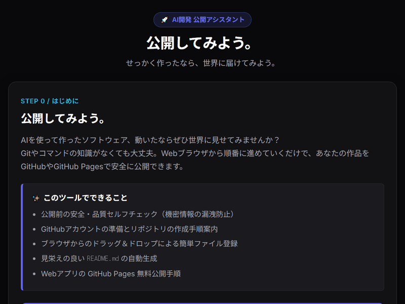

# 公開してみよう。

## AI開発 公開アシスタント

> せっかく作ったなら、
> 公開してみよう。

AIを使ってソフトウェアを作った。

動いた。

自分でも使える。

でも、

> 「これ、どうやって人に見せればいいの？」

となることがあります。

このツールは、作ったソフトウェアをGitHubなどで公開するための手順を案内するWebツールです。

🔗 **公開URL（GitHub Pages）**: [https://zero-dev.jp/kokai-shitemiyou-tool/](https://zero-dev.jp/kokai-shitemiyou-tool/)

---

## コンセプト

自分だけで使うのもいい。

でも、せっかく作ったなら公開してみる。

完成度にこだわりすぎなくても構いません。

小さなツールでも構いません。

まず公開してみる。

公開すると、

- 誰かに使ってもらえる
- 意見をもらえる
- バグが見つかる
- 改善点が分かる
- 次に作るものが見えてくる

ことがあります。

---

## 対応端末・動作環境

- **対応端末**: スマートフォンを基本とし、PCブラウザでも利用できます。
- **インストール**: 不要です。GitHub Pages 上の公開URLをWebブラウザで開いて利用します。

---

## 使い方

画面の案内に沿って、Step 1 から Step 8 まで順番に進めます。

### 1. ツール情報の入力（Step 1）

ソフトウェア名・ツール名、種類（クイック選択）、用途や概要、著作権者名（GitHubユーザー名または氏名）を入力します。

### 2. 公開前チェック（Step 2）

動作確認、必要なファイルや文書の有無、APIキー・パスワード・個人情報などの機密情報が含まれていないかをチェックリストで確認します。AIにコードを診断してもらうための質問文もコピーできます。

### 3. GitHubの準備（Step 3）

GitHubアカウントを持っているかを確認し、未作成の場合はアカウント登録の手順を案内します。

### 4. リポジトリの作成（Step 4）

入力したツール名から半角英数字のリポジトリ名候補を確認・調整し、GitHub上で新しいリポジトリを作成する手順（Repository name、Description、Public設定）を案内します。

### 5. ファイルの登録（Step 5）

Gitコマンドを使わずに、GitHubのWeb画面からドラッグ＆ドロップでファイルを登録する手順を案内します。

### 6. READMEとライセンス（Step 6）

Step 1 の入力内容を反映した `README.md` のたたき台、AIに詳しいREADMEを相談するためのプロンプト、およびライセンスの例（MIT License と他のライセンスの確認先）を提示します。

### 7. GitHub Pagesで公開（Step 7）

Webアプリの場合に、GitHub Pages を有効化して公開URLを確認する手順を案内します。

### 8. 公開後の確認（Step 8）

公開URLのページ表示、リンク動作、JavaScriptの動作、画像・アイコン表示、GitHub上でのREADME表示の5項目を確認します。困ったときのAI相談用質問文もコピーできます。

---

## 最初から完成形を目指さなくていい

公開するときに、

> 「まだ完成していないから公開できない」

と思う必要はありません。

小さなツールなら、

> **まず公開して、あとから直す。**

でもいい。

READMEに、

> 「現在開発中です」

と書いても構いません。

---

## データの取り扱い

- 入力内容とチェック状態は、ご利用中のブラウザの `localStorage` へ自動保存されます。
- 入力データは外部サーバーへ送信されません。
- 画面下部の「最初からやり直す（リセット）」から確認ダイアログを実行すると、保存内容を消去して初期状態に戻せます。

---

## GitHub Pages

Webツールの場合は、GitHub Pagesを使って公開することもできます。

本ツール自身も GitHub Pages で公開済みです。

- 公開URL: [https://zero-dev.jp/kokai-shitemiyou-tool/](https://zero-dev.jp/kokai-shitemiyou-tool/)

---

## このツールがしないこと

このツール自身がGitHubへファイルをアップロードするわけではありません。

GitHubアカウントを操作することもしません。

Git操作を自動化するツールでもありません。

目的は、

> **「GitHubで公開してみる」ための最初の手順を案内すること。**

です。

---

## 対象

- AIでソフトウェアを作った人
- GitHubを使ったことがない人
- 自分の作品を公開してみたい人
- OSSを始めてみたい人
- AI開発初心者

---

## 公開

GitHub Pages（[https://zero-dev.jp/kokai-shitemiyou-tool/](https://zero-dev.jp/kokai-shitemiyou-tool/)）で利用できる無料Webツールとして公開しています。

インストールは必要ありません。

---

## ライセンス

### MIT License

Copyright (c) 2026 tk030

Permission is hereby granted, free of charge, to any person obtaining a copy
of this software and associated documentation files (the "Software"), to deal
in the Software without restriction, including without limitation the rights
to use, copy, modify, merge, publish, distribute, sublicense, and/or sell
copies of the Software, and to permit persons to whom the Software is
furnished to do so, subject to the following conditions:

The above copyright notice and this permission notice shall be included in all
copies or substantial portions of the Software.

THE SOFTWARE IS PROVIDED "AS IS", WITHOUT WARRANTY OF ANY KIND, EXPRESS OR
IMPLIED, INCLUDING BUT NOT LIMITED TO THE WARRANTIES OF MERCHANTABILITY,
FITNESS FOR A PARTICULAR PURPOSE AND NONINFRINGEMENT. IN NO EVENT SHALL THE
AUTHORS OR COPYRIGHT HOLDERS BE LIABLE FOR ANY CLAIM, DAMAGES OR OTHER
LIABILITY, WHETHER IN AN ACTION OF CONTRACT, TORT OR OTHERWISE, ARISING FROM,
OUT OF OR IN CONNECTION WITH THE SOFTWARE OR THE USE OR OTHER DEALINGS IN THE
SOFTWARE.

